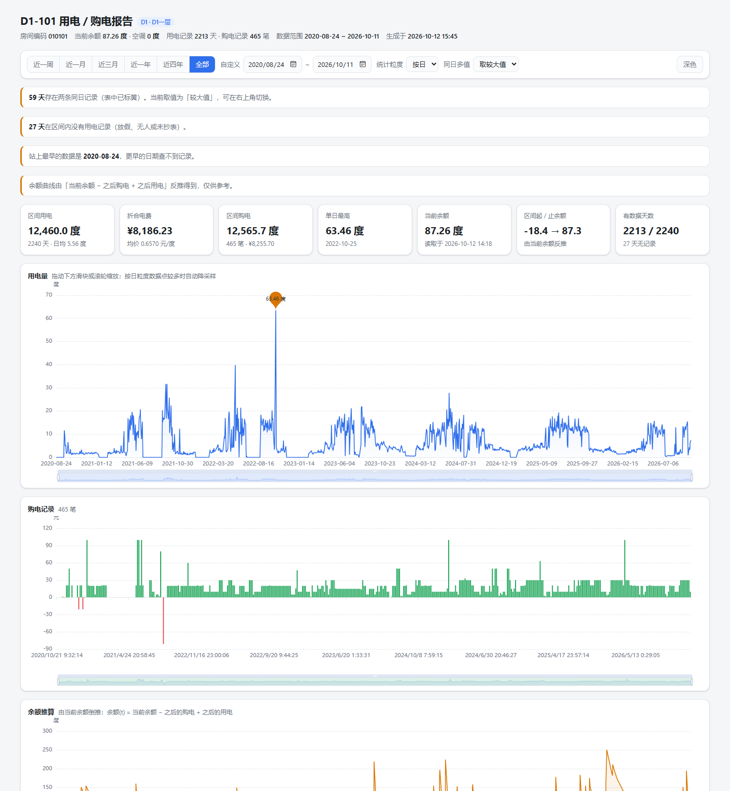

# 佛大宿舍电费查询 Skill

查询佛山大学（佛科院）公开的宿舍用电查询系统 —— **不需要账号密码**，直接报宿舍号就能拿到用电记录、购电记录、剩余电量，并生成一张**完全离线的单文件交互式图表报告**。

> 输入一句话：`查一下 D13-1001 最近一年的电费`
> 输出：一张 1MB 左右的 HTML，双击就能看，能缩放、能切时间段、能按日/周/月聚合，断网也能打开，可以直接转发给同学。



---

## 目录

- [和其他实现相比快在哪](#和其他实现相比快在哪)
- [快速开始](#快速开始)
- [使用方法](#使用方法)
- [支持的宿舍范围](#支持的宿舍范围)
- [报告能做什么](#报告能做什么)
- [性能实测](#性能实测)
- [工作原理](#工作原理)
- [数据说明与已知的坑](#数据说明与已知的坑)
- [项目结构](#项目结构)
- [缓存与隐私](#缓存与隐私)
- [常见问题](#常见问题)

---

## 和其他实现相比快在哪

| | 旧方案（Playwright 浏览器自动化） | 本方案（纯 HTTP + 时间分片并发） |
|---|---|---|
| 查 4 年数据 | 30 分钟以上 | 约 **3 分钟**（全量），之后每次 **2 秒** |
| 是否需要浏览器 | 要装 Playwright + Chrome/Edge | 不需要，只需 Node |
| 图表 | 预先画好 SVG 占位 | 交互式折线图，可缩放/切时间段 |
| 定位 | 逐页点击翻页 | 直接 POST 表单，绕开分页瓶颈 |

提速的关键不是"更快的爬虫"，而是**绕开了网站自身的三个性能陷阱**，详见[工作原理](#工作原理)。

---

## 快速开始

### 环境要求

- **Node.js 18+**（推荐 20+，用到全局 `fetch` 和 `AbortSignal.timeout`）
- 能访问校园网的网络环境（`http://10.10.60.223:8010/`）

### 安装

**方式一：作为 DSH 技能安装（推荐）**

```powershell
git clone https://github.com/CadenAlgo/Fosu-Electricity-Bill-Inquiry-Skill.git `
  "$env:USERPROFILE\.dsh\skills\electricity-query"
```

克隆到 `~/.dsh/skills/` 下之后，DSH 会自动发现它，之后直接用中文提问即可。

> 目录名必须是 `electricity-query`，和 `SKILL.md` 里的 `name` 保持一致。

**方式二：当普通命令行工具用**

```powershell
git clone https://github.com/CadenAlgo/Fosu-Electricity-Bill-Inquiry-Skill.git
cd Fosu-Electricity-Bill-Inquiry-Skill
node scripts/electricity.mjs --room D1-101 --open
```

---

## 使用方法

### 一、在 DSH 聊天框里直接用（推荐）

直接用中文说就行，会自动识别并调用：

```text
查一下 D13-1001 最近一年的电费
国交-305 这学期用了多少电
帮我看看 D1-101 最近一个月的用电和购电记录
河滨-201 从 2023 年到现在每个月的用电量
```

触发关键词：查电费 / 宿舍用电 / 剩余电量 / 购电记录 / 电费曲线 / 用电趋势 / 用了多少度电。

### 二、命令行

```powershell
# 最常用：增量抓取 + 生成报告 + 用 Edge 打开
node scripts/electricity.mjs --room D1-101 --open

# 只看最近一个月（首次查询很快，几秒）
node scripts/electricity.mjs --room D13-1001 --from 2026-09-01

# 重抓全部历史
node scripts/electricity.mjs --room 国交-305 --full

# 只用已有缓存重新出图（不联网）
node scripts/electricity.mjs --room D1-101 --report-only --theme dark
```

#### 参数

| 参数 | 说明 |
|---|---|
| `--room, -r <名字>` | 宿舍号，见下方[支持的写法](#宿舍号的写法) |
| `--from <YYYY-MM-DD>` | 起始日期，默认 `2020-01-01` |
| `--to <YYYY-MM-DD>` | 结束日期，默认今天 |
| `--conc <n>` | 并发会话数，默认 `12`。实测**不要超过 16**，20 反而更慢 |
| `--policy <p>` | 同一天有多条记录时的取舍：`max`（默认）/ `sum` / `min` / `first` / `last` |
| `--theme <t>` | 报告主题：`light`（默认）/ `dark` |
| `--full` | 忽略缓存，整段重抓 |
| `--report-only` | 只用缓存出图，不联网 |
| `--no-report` | 只抓数据不出图 |
| `--out <file>` | 指定报告输出路径 |
| `--refresh-catalog` | 强制重建房间目录 |
| `--open` | 生成后用 **Edge** 打开 |
| `--json` | 输出机器可读的摘要 |
| `--quiet, -q` | 安静模式 |

#### 房间目录工具

```powershell
# 查看所有楼栋 / 楼层 / 房间
node scripts/catalog.mjs --summary

# 重建房间目录（约 2 秒）
node scripts/catalog.mjs
```

---

## 支持的宿舍范围

- **D1 ~ D41** 共 40 栋楼（编号跳过 D11、D12、D19，网站上就没有）
- **国交**（8 层）、**河滨**（6 层）

各栋楼层数不一样，脚本会自动查表：

| 楼栋 | 层数 |
|---|---|
| D1 ~ D10、D14 ~ D18、D34、D35、D37 ~ D40 | 6 层 |
| **D13** | **14 层** |
| D20、D21、D22、D24 ~ D27、D30、D41 | 7 层 |
| D23、D29、D33、D36 | 8 层 |
| D28 | 4 层 |
| D31 | 3 层 |
| D32 | 5 层 |
| 国交 | 8 层 |
| 河滨 | 6 层 |

### 宿舍号的写法

以下写法全部等价，随便用哪种：

| 你输入 | 解析成 |
|---|---|
| `D1-101` / `D1101` / `d1 101` | D1 一层 01 室 |
| `D13-1001` / `D131001` | **D13 十层 01 室**（四位房号） |
| `国交-101` / `国交101` | 国交 一层 01 室 |
| `河滨115` | 河滨 一层 15 室 |
| `010101` | 直接用 6 位编码 |
| `D1-值班室` / `D7-备用` / `D30-1单元公共` | 非数字房间也能查 |

### 房间编码规则

网站的下拉框值是 **6 位数字：`楼栋(2位) + 楼层(2位) + 房号(2位)`**

```text
D1-101   →  01 01 01  →  010101
D13-1001 →  13 10 01  →  131001
国交-101  →  42 01 01  →  420101
河滨-115  →  43 01 15  →  430115
```

> ⚠️ **房间号不能靠算，必须查表。** 反例：
> - `D13` 一层是从 `D13-104` 开始的，不是 101
> - `D1` 一层最后一个是 `D1-值班室`
> - `D30` 有 `D30-1单元公共` 这种房间
> - `D20一层` 在网站上重复出现了两次；`D23一层`、`D31一层` 有楼层但没有房间

脚本会先抓一份完整目录（40 栋 / 262 层 / **4773 个房间**）做查表，查不到时会给出相近房间名建议。

---

## 报告能做什么

生成的 HTML 是**自包含单文件**（ECharts 已内嵌，约 1MB），不依赖任何 CDN：

- **时间段快捷切换**：近一周 / 近一月 / 近三月 / 近一年 / 近四年 / 全部，也可以手动选起止日期
- **统计粒度切换**：按日 / 按周 / 按月（看长周期时按月更清楚）
- **同日多值取舍切换**：图上实时重算，不用重新抓数据
- **用电量折线图**：可滚轮缩放、拖拽滑块，自动标出最高的一天
- **购电记录柱状图**：退款/冲正显示为红色负值柱
- **余额推算曲线**：由当前余额反推历史每一天的余额，能看出"什么时候充的钱、什么时候用掉的"
- **统计卡**：区间总用电、折合电费、区间购电、单日最高、当前余额、区间起止余额、数据完整度
- **明细表**：按日/按笔列出，同日多条的日期标黄
- **深色模式**

---

## 性能实测

网站的 `OFFSET` 分页会随结果集变大而**急剧变慢**，所以分片大小直接决定速度。冷缓存实测（2 年 / 731 条记录）：

| 分片大小 | 并发 | 耗时 | 每条记录 |
|---|---|---|---|
| **6 天** | **12** | **12.8s** | **17ms** ✅ |
| 12 天 | 12 | 23.0s | 31ms |
| 20 天 | 12 | 33.6s | 46ms |
| 30 天 | 6 | 72.7s | 99ms |
| 90 天 | 6 | 156.1s | 213ms |
| 12 天 | 20 | 46.4s | 63ms（并发过高反而更慢） |

**实际使用：**

| 场景 | 耗时 |
|---|---|
| 首次查询某宿舍全部历史（2020-08 至今，约 2200 条用电 + 460 条购电） | 约 3 分钟 |
| 首次查询但只指定短时间段（如最近一个月） | 几秒 |
| 已查过的宿舍，增量更新 | **约 2 秒** |

> 学校服务器在持续压力下会明显变慢（同一批分片，短时测试 14 请求/秒，长跑时降到约 3.6 请求/秒），所以并发别调太高，收益不大反而更慢。

---

## 工作原理

这一节解释为什么这样做，以及踩过的坑。看懂了可以自己改。

### 1. 网站是什么

`http://10.10.60.223:8010/` 是一个 **ASP.NET WebForms**（IIS 8.0）应用，没有登录，但也不是普通表单：

- 所有请求都是 POST 回**应用根目录**（Default.aspx），靠隐藏字段 `__EVENTTARGET` 指定"哪个控件触发了回发"
- 下拉框是**级联**的：选楼栋 → 服务器返回该楼栋的楼层列表；选楼层 → 返回房间列表
- 点"查询"按钮（`ImageButton1`）后服务器返回 **302** 跳转到 `/usedRecord.aspx` 或 `/buyRecord.aspx`
- 结果页才有日期过滤（`txtstart` / `txtend` / `btnser`）和分页（`?p=N`，**每页固定 10 条**）

完整流程：

```text
GET  /                                  → 楼栋列表 + __VIEWSTATE
POST /  __EVENTTARGET=drlouming         → 该楼栋的楼层列表
POST /  __EVENTTARGET=drceng            → 该楼层的房间列表
POST /  drfangjian + radio + ImageButton1.x/y
                                        → 302 到 /usedRecord.aspx
GET  /usedRecord.aspx                   → 结果页（含日期过滤框）
POST /usedRecord.aspx  txtstart/txtend  → 过滤后的第 1 页
GET  /usedRecord.aspx?p=N               → 过滤后的第 N 页
```

### 2. 三个坑（不处理就查不出数据）

**坑一：编码混用。** `Default.aspx` 的 HTTP 头声明 `charset=gb2312`，而 `usedRecord.aspx` 是 UTF-8，偏偏 GB2312 那个页面的 HTML `<meta>` 里写的还是 `utf-8`（骗人的）。所以必须**以 HTTP 响应头为准**动态选择解码器，否则中文全是乱码，连房间名都匹配不上。

**坑二：Session Cookie。** 首页 GET 不下发任何 Cookie，只有**房间选择的那个 POST** 才会下发 `ASP.NET_SessionId`，而结果页要从 Session 里读回"你选的是哪个房间"。不维护 Cookie 罐的话，跳转到结果页会被踢回登录页。

**坑三：302 不能自动跟随。** 房间选择的 POST 返回 302 后，必须**自己带着 Referer 去 GET 目标地址**；用 `fetch` 的 `redirect: 'follow'` 会在跳转过程中丢掉上下文，拿到的是空白表单页。

### 3. 三个性能陷阱（决定快慢的关键）

**陷阱一：`OFFSET` 分页随范围变宽急剧变慢。**

服务端分页看起来是 `OFFSET n LIMIT 10`，代价随结果集增大而暴涨。实测：

| 查询范围 | 总页数 | 每页耗时 |
|---|---|---|
| 1 个月 | 4 页 | 0.3 秒 |
| 10 个月 | 29 页 | 1.0 秒 |
| 6.7 年 | 229 页 | **4.4 秒** |

所以**不能**"一次查 4 年然后翻 229 页"（229 × 4.4s ≈ 17 分钟）。正确做法是把日期**切成小片**，每片独立查询，每片都很便宜。

**陷阱二：ASP.NET 的 Session 锁会把并发请求串行化。**

同一个 `ASP.NET_SessionId` 的并发请求，服务端是**排队处理**的。实测同一个 session 并发 8 个请求要 **23 秒**（比串行还慢），而用 8 个独立 session 只要 16 秒。所以并发必须是**多个独立 session**，每个 session 内部串行。

**陷阱三：服务器有查询缓存，冷热差距 10 倍。**

同一个 (房间, 日期区间) 查询，第一次（冷）约 1.4 秒，第二次（热）只要 0.11 秒。这解释了为什么"随便测一下"会得出过于乐观的结论 —— 测试区间已经被前一次测试捂热了。**做性能测试必须换没查过的房间。**

### 4. 最终策略

```text
把 [起始日, 结束日] 按 6 天切片
        ↓
开 N 个独立 session（每个 session 各自完成一次"选楼栋→选楼层→选房间"）
        ↓
每个 session 从队列里领一个时间片：
     1 次 POST 设置日期过滤 → 拿到总页数
     再 GET 第 2..T 页
        ↓
所有记录按日期合并进本地 JSON 缓存
```

每个 session 的启动成本是 6 次请求（选房间的级联），所以 session 不能开太多；实测 12 个是最佳点。

### 5. 本地缓存与增量更新

缓存按"已覆盖日期区间"记录进度：

- 首次查询：抓 `[起始日, 今天]`
- 之后每次：只抓 `[上次最后日期 - 7天, 今天]` —— 留 7 天重叠窗口，是因为网站有时会**补录或修正**最近的数据
- 如果这次要求的起始日比缓存更早，只补抓缺的那一段

每个时间片抓完立刻落盘，所以中途中断重跑会自动续上，不会从头再来。

### 6. 两个数据上的坑

**同日两条记录。** 约 70 天服务器会返回两条同日但数值不同的记录（例如 `2022-06-06` 同时有 11.07 和 12.23 度）。缓存把**原始条目全部保留**，取舍策略放到报告里实时计算，所以切换策略不需要重新抓数据。默认取**较大值**——因为日常用量普遍在 3~13 度，相加会出现 20+ 度的异常尖峰，更像是同一块表的两次读数或一次修正。

**购电记录里有负数。** 退款/冲正会以负值出现（如 `-1.00 度 / -0.66 元`），图表里用红色柱子区分。

### 7. 余额是怎么反推出来的

网站只告诉你**当前**余额。历史余额可以用能量守恒倒推：

```text
余额(t) = 当前余额 − (t 之后的所有购电) + (t 之后的所有用电)
```

报告里的橙色曲线就是这么来的。两个实现细节值得注意：

1. 后缀和必须在**稠密日历**上累加 —— 购电经常发生在**没有用电记录的那一天**（放假、无人），如果只沿着"有用电记录的日期"累加就会漏掉（实测漏了 138.5 度）。
2. 没用电记录的日子必须**继承**running total，不能回退成"当前余额"，否则曲线会出现假尖峰。

这条曲线是**推算值**，数据有缺口时会累积误差，报告里也标注了"仅供参考"。

---

## 数据说明与已知的坑

- **数据起点**：网站上最早的数据是 **2020-08 左右**，更早的日期查不到记录
- **缺数据的天**：放假或无人时没有记录，报告按"无记录"处理，并在统计卡里提示缺了多少天
- **购电含退款**：见上文
- **网站自身的数据问题**：`D20一层` 重复出现、`D23一层`/`D31一层` 无房间、房间编号不连续（`D13` 一层从 104 开始）—— 这些都是网站上真实存在的，脚本按原样处理

---

## 项目结构

```text
.
├─ README.md                  本文件
├─ SKILL.md                   给 AI agent 的调用规则
├─ config.json                默认并发 / 取舍策略 / 主题 / 浏览器
├─ .gitignore                 忽略 data/ 和 out/
├─ scripts/
│  ├─ electricity.mjs         主命令：抓取 + 出图
│  ├─ catalog.mjs             房间目录抓取
│  └─ lib/
│     ├─ client.mjs           HTTP 客户端（编码识别、Cookie、重试、耗时统计）
│     ├─ site.mjs             站点流程：级联选择、时间分片并发抓取、记录解析
│     ├─ rooms.mjs            房间名解析、别名、模糊匹配
│     ├─ catalog.mjs          房间目录构建
│     ├─ cache.mjs            本地缓存、增量合并、取舍策略
│     ├─ dates.mjs            日期工具
│     └─ report.mjs           生成自包含 HTML
├─ assets/
│  ├─ echarts.min.js          内嵌进报告，保证离线可用
│  ├─ report.js               报告运行时（图表与统计）
│  └─ report.css              报告样式（含深色主题）
├─ docs/
│  └─ preview.png             README 截图
├─ data/                      （已 gitignore）房间目录 + 各宿舍缓存
└─ out/                       （已 gitignore）生成的报告
```

---

## 缓存与隐私

- 所有缓存都在你**本机**的 `data/` 目录，**已被 `.gitignore` 忽略，不会提交**
- 生成的报告在 `out/`，同样被忽略
- 仓库里不含任何账号、密码、Cookie、个人宿舍数据
- 第一次运行会自动构建房间目录（`data/rooms.json`，约 2 秒），这个文件也可以随时删掉重建
- ⚠️ 请不要用 `git add -f` 把 `data/` 加进提交

---

## 常见问题

**Q：报告打开是空白的？**
用 Edge 或其它浏览器打开 `out/*.html`。文件是完全自包含的，不需要联网。如果默认浏览器是 Chrome 且装了代理插件，可能加载不出来。

**Q：提示"房间选择被拒绝"？**
先 `node scripts/catalog.mjs` 重建房间目录，再确认房间号拼写。脚本会给出相近的房间名建议。

**Q：数据看着不对？**
加 `--full` 整段重抓；再试试 `--policy` 换一种同日多值取舍。

**Q：为什么第一次查这么慢？**
在回填全部历史（约 2200 条记录）。只关心近期的话，加 `--from 2026-09-01` 就几秒出图，之后再逐步往前补。

**Q：`node` 命令找不到？**
DSH 自带的 Node 在 `%USERPROFILE%\.dsh\dsh-runtimes\dsh-primary-runtime\dependencies\node\bin\node.exe`，用绝对路径调用即可。或者自己装一个 Node 18+。

---

## 免责声明

本项目只做**只读查询**，不涉及购电、缴费或任何账户修改，也不需要账号密码。
查询的是学校**公开**的用电查询页面，请遵守学校相关规定和网络使用政策，不要高频刷取给服务器造成压力。
本项目与学校官方无关。
